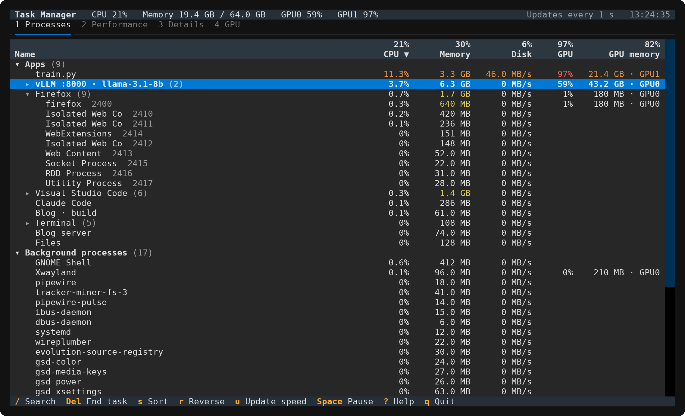
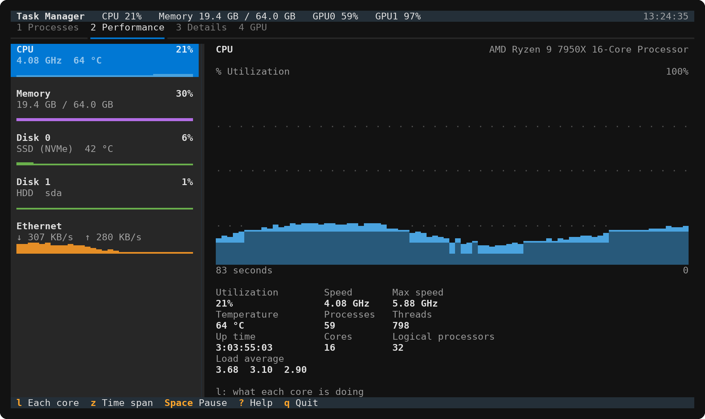
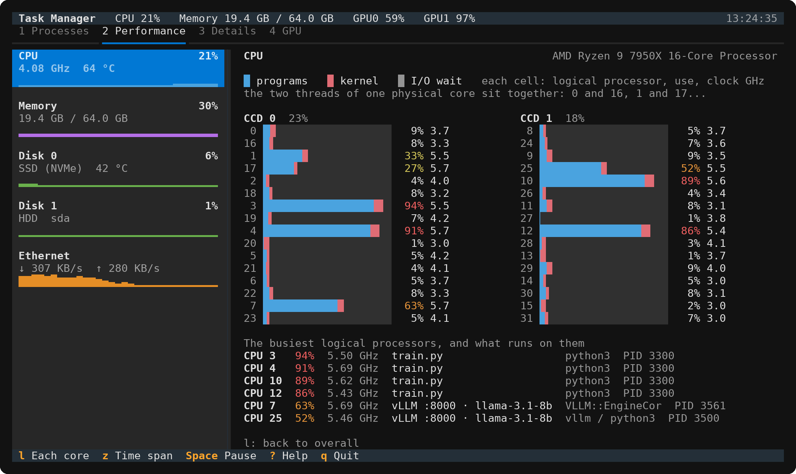
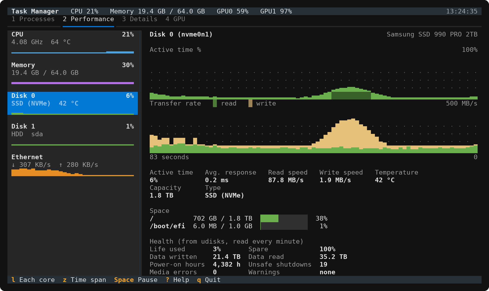
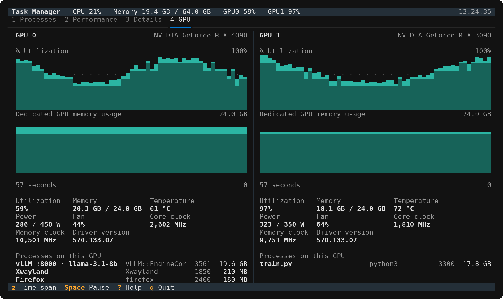

# Task Manager for the Linux terminal

[繁體中文](README.zh-TW.md)

A task manager for the terminal, laid out like the one in Windows: processes grouped by app, graphs
over time for the CPU, memory, each disk and each network adapter, every NVIDIA GPU side by side on a
tab of its own, and a view of what every CPU core is doing.



## What it shows

**Processes**: one row per app, grouped the way Windows groups them. A browser and its helper
processes are one row, and so is a terminal with its shells; each command typed in a terminal is a
row of its own. Rows are sorted into Apps, Background processes and System processes. Each row shows
CPU, memory, disk and, with an NVIDIA card, GPU and GPU memory, with the machine's totals above the
column names. Enter expands a group, and Del ends a task after asking (SIGTERM, or SIGKILL to force).

**Performance**: CPU, memory, each disk and each network adapter, every one with a graph.



- **CPU**: use, clock, temperature (AMD, Intel and many ARM boards), processes, threads and up time.
  Press `l` to see each logical processor: its use split into programs, kernel and I/O wait, and its
  clock. The two threads of each physical core sit side by side, and cores that share an L3 cache form
  a column (one CCD on AMD chips). Below the grid are the busiest processors and the program on each.

  

- **Disk**: active time, and read and write speed stacked in one graph. It also shows the drive's
  temperature and how full each partition is. NVMe drives get their health too: life used, spare, data
  written, power-on hours, unsafe shutdowns, media errors and warnings. Health comes from udisks, the
  service GNOME Disks reads, so no root is needed.

  

- **Network**: receive and send stacked in one graph, link speed, addresses and totals.

**Details**: one row per process, with PID, status, user, threads and command line.

**GPU** (NVIDIA, through NVML): every card at once, side by side. Each one has graphs of its use and
memory over the same span of time, its temperature, power, fan and clocks, and the processes on it with
how much memory each holds. Cards that do not fit across the window wrap into rows, and the tab
scrolls when the window is too small for them. The tab is there only when an NVIDIA card is.



## Requirements

- Linux: it reads `/proc` and `/sys`.
- Python 3.11 or newer.
- A terminal with true color. 120 × 36 or larger shows the most, and 80 × 24 works.
- Optional: an NVIDIA driver for the GPU parts, and udisks2 for NVMe health. Most desktops have udisks2.

## Install

```sh
git clone https://github.com/Yanori1220/taskmgr.git
cd taskmgr
./install.sh
```

`install.sh` makes a Python environment in `venv/` from the pinned `requirements.txt`. It then adds
"Task Manager" to the app grid. The icon opens it in GNOME Terminal at 130 × 40 if GNOME Terminal is
installed, and in your default terminal otherwise. `./install.sh --uninstall` removes the icon.

Run it with `./taskmgr`, or link it onto your PATH: `ln -s "$PWD/taskmgr" ~/.local/bin/taskmgr`.

## Use

```
taskmgr                  refresh every second
taskmgr --interval 2     refresh every 2 seconds
taskmgr --lang zh        Traditional Chinese labels
taskmgr --ascii          graphs in plain ASCII (automatic on the Linux console)
```

| Key | |
|---|---|
| `1` `2` `3` `4` | Processes / Performance / Details / GPU (or click the tabs) |
| Up, Down, PgUp, PgDn | move |
| Enter | expand or collapse a group or section (mouse: click to select, click again to expand) |
| `/` | search by name, PID or command line; Esc clears |
| `s` / `r` | next sort column / reverse it (or click a column name) |
| Del or `k` | end task (asks first) |
| `l` | on the CPU page: overall / each core |
| `z` | Performance and GPU tabs: the graphs cover one reading per column, 5 minutes or 15 minutes |
| Space | pause / resume |
| `?` | help |
| `q` or Ctrl+C | quit |

To select text on the screen, hold Shift while you drag.

## Group your own projects

Python programs all look alike in a process list. You can list your project folders in
`~/.config/taskmgr/groups.toml`, or in `$XDG_CONFIG_HOME/taskmgr/groups.toml` if that is set:

```toml
[[project]]
name = "Blog"
dir = "~/code/blog"

  [project.scripts."serve.py"]
  name = "Blog server"
  end_note = "Saves drafts on SIGTERM; Force does not."
```

Each Python program whose script is inside `dir` becomes a group of its own, named
"Blog · <script>". So does a program run with `python -m <module>` from `dir`: `-m tools.build`
shows as "Blog · build". A script or module listed under `scripts` shows its own `name` instead. Its
`end_note` is added to the End task dialog, which helps for a program that does something on SIGTERM.
With `--lang zh`, `name_zh` and `end_note_zh` are used when they are there.

The file is read when Task Manager starts. If it has a mistake, a notice says what it is and project
groups stay off until the file is fixed.

## How the numbers are worked out

- **CPU**: a share of the whole machine. All logical processors busy is 100%, as in Windows.
- **Memory**: what a process holds for itself, which is resident memory minus file-backed and shared
  pages. This is close to Windows' private working set.
- **Disk**: bytes per second really read from and written to storage.
- **GPU memory**: the same figure as `nvidia-smi` (NVML's v2 memory info, which leaves out what the
  driver reserves). Cards are numbered as `nvidia-smi` numbers them.
- **Groups**: vLLM servers are grouped by port and named after `--served-model-name`. PostgreSQL,
  Claude Code and the kernel's threads are one group each. Other apps take their name from their
  `.desktop` file.

## What Linux does not show

- How much network each process uses is hidden from an ordinary user, so only adapter totals are shown.
- Other users' processes show CPU and memory but not disk I/O, and ending them needs sudo.

## Cost

It reads `/proc` itself instead of creating psutil objects for every process. On a 64-thread desktop,
one reading takes about 30 ms, and the app uses 4–7% of one core and about 80 MB of memory.

## Notes

- It was developed on Ubuntu 24.04 with GNOME, an AMD CPU and NVIDIA GPUs. Other set-ups were
  checked with simulated hardware only: Intel, no NVIDIA, SATA disks, Wi-Fi and virtual machines.
- The screenshots are drawn from a made-up machine by `docs/make_screenshots.py`, so nothing in them
  is real.
- This is not affiliated with Microsoft. "Windows Task Manager" is named only as the layout it follows.

## License

MIT
