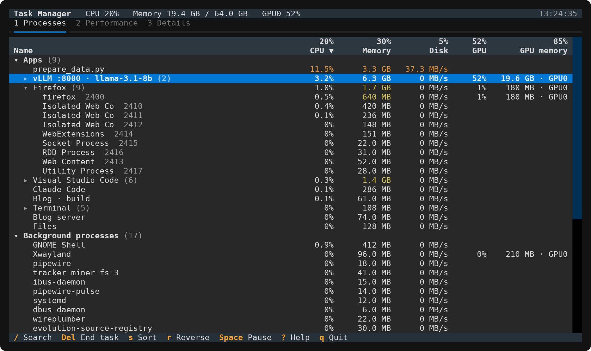

# Task Manager（終端機版）

English: [README.md](README.md)

照 Windows 的工作管理員做的終端機版，給 Linux 用。介面預設是英文，加 `--lang zh` 是中文。



## 裝

```sh
git clone https://github.com/Yanori1220/taskmgr.git
cd taskmgr
./install.sh
```

`install.sh` 做兩件事：在 `venv/` 建 Python 環境（照 `requirements.txt` 的版本），然後把「Task Manager」
加到 app 選單。有 GNOME 終端機就用它開成 130×40，沒有就用預設的終端機。`./install.sh --uninstall`
把圖示拿掉。

需要 Linux 和 Python 3.11 以上。NVIDIA 驅動（GPU 的部分）和 udisks2（NVMe 的健康度）有的話就顯示，
沒有的話那幾個地方就不出現。

## 開

```
./taskmgr                  每 1 秒更新
./taskmgr --interval 2     每 2 秒更新
./taskmgr --lang zh        中文介面（純文字畫面 Ctrl+Alt+F3 沒有中文字型，那裡別用）
./taskmgr --ascii          圖只用 ASCII 字元
```

在純文字畫面（Ctrl+Alt+F3）圖會自動改成 ASCII。從別台電腦 ssh 進來也能開。
裡面按 `?` 看所有按鍵；`q` 或 Ctrl+C 離開。

## 三個分頁

- **Processes**（處理程序）：同一個 app 的程式收成一組，像瀏覽器和它的子程式；終端機和它的 shell 也是
  一組，在終端機裡打的指令各自一組。分成 Apps、Background processes、System processes 三區，
  欄位名稱上面是整台的總量。Enter（或滑鼠點兩下）展開一組；`Del` 是 End task（結束工作），會先問。
- **Performance**（效能）：CPU、Memory、每顆磁碟、每張網卡、每張 NVIDIA 顯示卡，各有跟著時間跑的圖。
  - CPU 按 `l` 看每個核心：每格一條長條，藍色是程式（programs）、紅色是系統核心（kernel：中斷、
    驅動程式）、灰色是等待 I/O，後面是使用率和現在的頻率。同一個實體核心的兩個執行緒排在一起；共用
    一塊 L3 快取的核心排成一欄（AMD 的晶片就是一塊 CCD）。下面列出最忙的邏輯處理器和上面在跑的程式。
    只追蹤用量超過一個核心約 3% 的程式；程式在核心之間換來換去時，算在它最後停的那個核心上，
    所以有時候會是「—」。
  - 磁碟：作用時間、傳輸速度（讀取綠色、寫入琥珀色疊在一起）、磁碟自己的溫度、每個分割區用了多少
    空間（超過 70% 變黃、90% 變紅）。NVMe 另外有健康度：壽命用掉、備用區、總寫入／讀取、開機時數、
    異常斷電、媒體錯誤、警告。健康度是 udisks（GNOME「磁碟」背後那個系統服務）給的，不用 root，
    每分鐘讀一次。
  - 網路：接收和傳送疊成一張圖，還有連線速度、位址、總量。
  - GPU：使用率、記憶體、溫度、功耗、風扇、時脈，最下面列出用這張卡的程式和各用多少記憶體。
- **Details**（詳細資料）：每個程式一列（不列核心執行緒），有 PID、狀態、使用者、命令列。

## 自己專案的分組

Python 程式在列表裡看起來都一樣。把自己的專案資料夾寫進 `~/.config/taskmgr/groups.toml`
（有設 `XDG_CONFIG_HOME` 的話在它底下），它們的程式就會照專案分組：

```toml
[[project]]
name = "Blog"
dir = "~/code/blog"

  [project.scripts."serve.py"]
  name = "Blog server"
  name_zh = "部落格伺服器"
  end_note = "Saves drafts on SIGTERM; Force does not."
```

- script 在 `dir` 裡面的 Python 程式，各自一組，叫「Blog · <script>」。
- 在 `dir` 裡用 `python -m <模組>` 跑的也是，名字取模組的最後一段：`-m tools.build` 是「Blog · build」。
- 寫在 `scripts` 底下的用自己的 `name`；`end_note` 會加在 End task 的確認視窗裡，適合收到 SIGTERM
  會做事的程式。`--lang zh` 時有 `name_zh`、`end_note_zh` 就用它們。

設定檔在 Task Manager 啟動時讀，改完要重開。寫錯的話會跳出提示說錯在哪，專案分組先關掉，直到改好。

## 數字怎麼算

- CPU：佔整台的百分比，所有邏輯處理器全滿是 100%，跟 Windows 一樣
- 記憶體：程式自己用掉的（RSS 減掉跟別人共用的檔案和共享記憶體），接近 Windows 的「私人工作集」
- 磁碟：每秒實際讀寫硬碟的量
- GPU 記憶體：跟 `nvidia-smi` 一樣的算法，卡的編號也一樣
- 分組：vLLM 依 port 分組，名字取 `--served-model-name`；PostgreSQL、Claude Code、Linux 核心的執行緒
  各收成一組；從桌面開的 app 用它 .desktop 檔裡的名字

## Linux 的限制

- 每個程式各用多少網路，一般使用者看不到，所以只有 Performance 分頁的總量。
- 別的使用者（root、postgres…）的程式：看得到 CPU 和記憶體，看不到磁碟讀寫（顯示「—」），結束要用 sudo。

## 檔案

- `taskmgr.py`：全部的程式
- `taskmgr`：啟動用的小腳本，用這個資料夾裡的 venv；做成連結放到 PATH 上也可以
- `install.sh`：建 venv、加 app 選單的圖示
- `icon.svg`：圖示
- `requirements.txt`：裝的套件版本
- `docs/`：README 的截圖，和畫截圖的 `make_screenshots.py`。截圖是用一台編出來的機器畫的，裡面沒有
  真的程式。要重畫的話先 `venv/bin/pip install pillow`，再 `venv/bin/python docs/make_screenshots.py`

## 成本

它自己讀 `/proc`，不幫每個程式建 psutil 物件。在 64 執行緒的桌機上，讀一次約 30 ms，它自己約用一個
核心的 4–7%、記憶體約 80 MB。

## 授權

MIT
